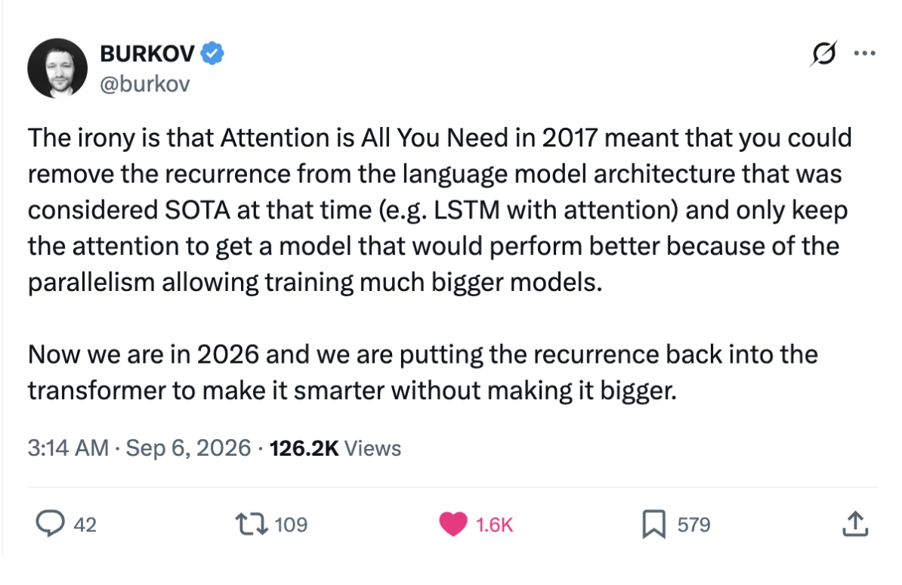
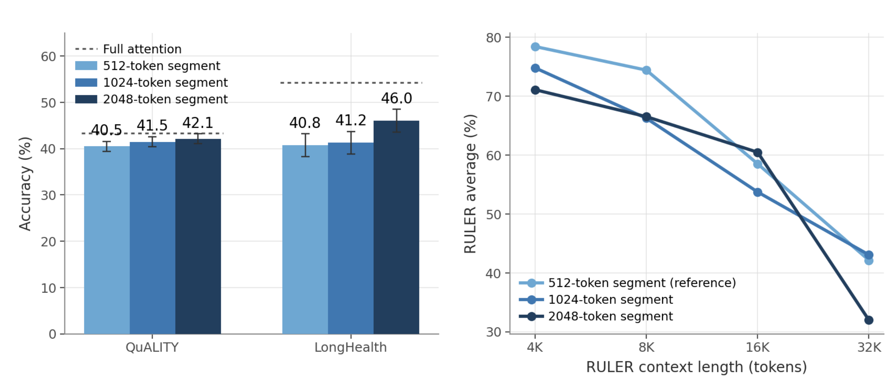
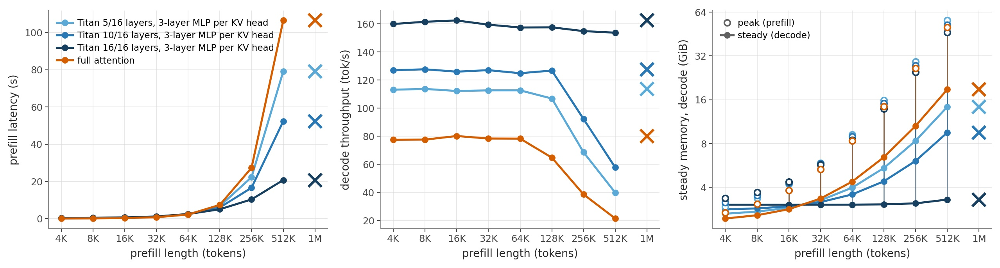

*Accepted to NeurIPS LCFM Workshop*

::: {.callout-note appearance="simple" icon="false"}
## TL;DR

We retrofit a pre-trained LLM to use RNNs for long-context dependencies. Attention capabilities scale well, but their quadratic asymptotic complexity creates engineering challenges when increasing sequence lengths. We train external “memory modules” on top of pre-trained LLMs that act as RNNs over early context.
:::

### Attention is great to train, less so to inference
Self-attention is great. When training, we use a causal attention mask and teacher forcing to calculate loss in parallel for tokens across a sequence. This is possible because every token corresponds to an independent query, key, and value vector, and we can blend representations across tokens through attention's lookup table mechanism. However, it is also because this very reason--that we must compute over historical keys and values--that it is asymptotically quadratic with respect to sequence length.

{width=40% fig-align="center"}

Token parallelism during training is one of the key drivers of the success of scaling attention, but management of cached KV values for each token is one of the key challenges to engineering high throughput inference systems. Perhaps it then makes sense to utilize the transformer when pre-training (to get our data’s worth) but avoid KV cache management at inference-time by **distilling model behavior into a different architecture as the final stage of post-training.**

Specifically, RNNs that are updated via test-time training have been used previously to model longer term dependencies while self-attention is used for short term ones [@zhang2025lact; @behrouz2024titanslearningmemorizetest]. In our work, we refer to them as neural memory modules (NMMs) as is done in Titans. This naturally reflects the lower fidelity of distant memories in humans versus the higher fidelity recall we have for recent events. Nonetheless, it is hard for a fixed-size state to encode all relevant information, and **the fundamental tradeoff then becomes that between inference speedups and model quality.**

{width=60% fig-align="center"}

### NMMs can significantly improve inference latency but reduce long context reasoning performance
In the first four layers of a one billion parameter Llama model, we apply a segmented mask to attention to simulate the inability of referencing historical context. The NMMs are then applied on token chunks and supply information as a residual approximating the historical attention output. We compute the final output as a learned linear interpolation between the local attention output and the historical attention output approximated by the NMM. 

{width=55% fig-align="center"}

Increasing the proportion of Titan-Llama layers is like slowly transitioning the model into a deep NMM with local attention windows.^[While we did not train configurations with increased number of layers adapted, we did choose the first four layers, which were empirically the most impactful on long-context understanding. Picking deeper layers would not have put pressure on the NMMs to supply the right information (as that had already been done by earlier layers), so positive results would have been harder to measure.
] The engineering to achieve these inference-time speedups was pretty superficial, with the results below as the result of implementing CUDA Graphs. Future engineering work may include designing specialized kernels and hunting down what causes the peak HBM memory usage.

{width=70% fig-align="center"}

As shown in the first chart, scaling token chunk size had a significant impact on performance. Here, chunk size refers to *both* the size of the local attention window and the token batch size used to train the NMM. This effect makes sense as larger chunk sizes means more tokens contained in full-fidelity attention. Prior literature also suggests that RNNs perform better with larger token batch sizes [@zhang2025lact; @feng2026inplacetesttimetraining].

**Future Work**  
- Can retrofitting model architecture with more compute (😅) result in *superior* performance?  
- How do we engineer inference pipelines so that architectural diversity within a model results in throughput performance, as opposed to slowdowns due to awkward memory partitioning?  
- Could context compaction in parameter space result in better information representation from a theoretical perspective?  
- Transitioning 16/16 layers? Expansion to other model families? 
- How to distill attention outputs directly into the NMM?
- Is KV binding loss the best inner objective for the NMM?
